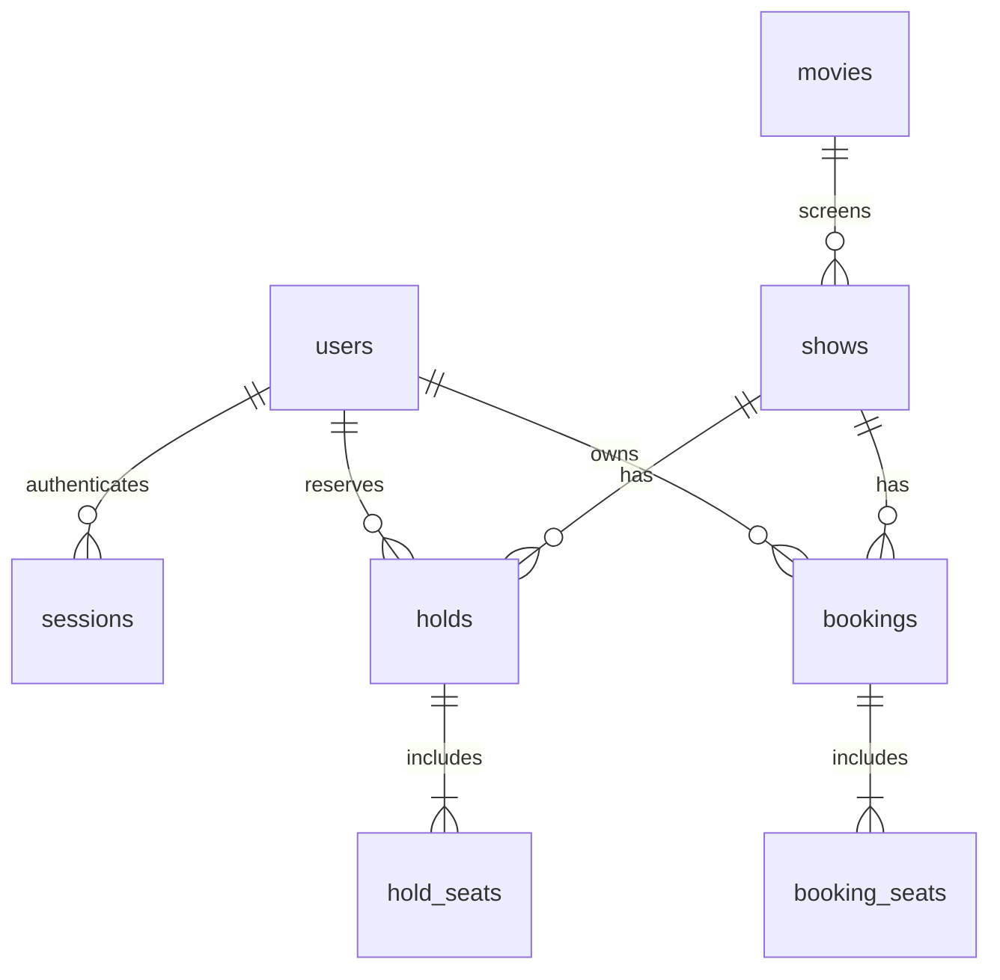

# FRAME

A cinema booking app with a sample film catalogue. Compare films, view dated screenings, reserve up to six seats, and confirm a simulated payment. Built with Astro, React, TypeScript, Fastify and PostgreSQL.

[2K screen recording and source archive](https://github.com/Itachi-1824/yozigo-cinema/releases/tag/submission-v1) · [Automated checks](https://github.com/Itachi-1824/yozigo-cinema/actions)

## Run with Docker

Install Git and Docker Desktop (or Docker Engine with Compose), then:

```sh
git clone https://github.com/Itachi-1824/yozigo-cinema.git
cd yozigo-cinema
docker compose up --build -d
```

Open **http://localhost:8080**. The API and database stay on the private container network; the database's development port is bound to loopback only. The setup script creates the schema and seeds an empty database. Running it again preserves existing bookings and applies the integrity migration.

```sh
docker compose down
```

The named database volume persists. Do not remove it to restart the app.

## Run for development

Requires Node.js 22.19+ and PostgreSQL 17+ (the supplied container is the easiest option).

```sh
npm ci
docker compose up -d db
npm run db:setup
npm run dev
```

Open **http://127.0.0.1:4321**. Astro proxies `/api` to the separate API at port 4000. Defaults work without an environment file. To use another database or change credentials, copy `.env.example` to `.env` and edit it before seeding. `APP_ORIGIN` must match the browser's origin exactly.

## Demo accounts

| Role | Email | Password |
|---|---|---|
| Customer | customer@frame.test | FrameGuest2026! |
| Second customer | rival@frame.test | FrameRival2026! |
| Admin | admin@frame.test | FrameAdmin2026! |

These are intentional local demo credentials. Public hosting requires replacing the default database password and seeded account passwords, setting a correct `APP_ORIGIN`, and serving over HTTPS with `NODE_ENV=production`. Normal sign-up always creates a customer. Payments are simulated; no payment provider is connected.

## Completed flows

1. Sign-up, login and logout with hashed passwords and cookie sessions.
2. Movie catalogue, search, genre filters, details and upcoming showtimes grouped by date.
3. Eight rows (A–H), ten seats each; available, held and booked states from the API.
4. Atomic five-minute holds for one to six seats, conflict feedback and countdown.
5. Simulated payment success/failure, retry, booking receipt and expired-hold rejection.
6. Own booking history and private ticket details.
7. Admin film CRUD and show creation/deletion with overlap and booking-history protection.
8. Upcoming booking cancellation at least two hours before the screening; seats release immediately.
9. Per-show occupancy, confirmed revenue, customer booking list and seat map.
10. Live seats through three-second polling, with visible connection errors and hold recovery on refresh.

The interface includes an opt-in sound toggle, reduced-motion support, keyboard focus management, and a horizontally scrollable mobile seat map that preserves full-size targets. Film imagery and fonts are local assets. Film stories, release dates, cast/crew and artwork are fictional sample content in `server/catalogue.json`; certifications are age classifications, not audience scores. Booking availability, holds and history use the working database.

The interface is informed by direct observations of BookMyShow, District and Fandango. [Screen study](docs/PLATFORM-RESEARCH.md) and [booking behavior sources](docs/BOOKING-BEHAVIOR-RESEARCH.md) distinguish observed screens, documented policies and design decisions.

## Key decisions

- Astro serves the page and bundles React; the interactive application is React with TypeScript.
- Fastify runs as a separate API, so authentication and booking rules remain independent of the UI.
- PostgreSQL owns durable data, time and concurrency; monetary amounts are integer paise.
- Every reservation mutation locks the show first, then its hold or booking, giving a consistent lock order.
- A partial unique index allows only one active booking for each show/seat; a composite foreign key prevents seats belonging to the wrong show.
- Holds expire according to the database clock. Reads exclude expired holds, so a background cleanup job is unnecessary for correctness.
- The single screen uses an exclusion constraint on `[start,end)` time ranges; adjacent shows are valid, overlapping shows are rejected.
- Opaque session cookies are HttpOnly; session tokens are hashed in the database, and mutations check CSRF tokens and browser origin.
- Polling is sufficient for eighty seats and one screen. Transactions, rather than live UI updates, protect correctness.
- Film discovery uses an editorial composition; checkout keeps price, seats, time and payment status explicit.

## Database design



| Table | Important columns and rules |
|---|---|
| `users` | id, name, unique normalized email, password_hash, customer/admin role |
| `sessions` | token_hash, user_id, csrf_token, expires_at |
| `movies` | id, title, description, language, duration_minutes, rating, poster_url, backdrop_url, genre, release_date, certification, credits, gallery, trailer_url, source_url |
| `shows` | movie_id, starts_at, ends_at, price_paise; exclusion constraint prevents overlaps |
| `holds` | UUID, show_id, user_id, expires_at, invalidated_at, booking_id |
| `hold_seats` | hold_id, seat_label; one entry per selected seat |
| `bookings` | UUID, show_id, user_id, amount_paise, status, created_at, cancelled_at |
| `booking_seats` | booking_id, show_id, seat_label, released_at; active-seat unique index and booking/show composite foreign key |

See [schema.sql](server/schema.sql) for the complete schema and [API contract](docs/CONTRACT.md) for routes. Cancellation keeps the booking and seat history while releasing active ownership.

## Checks

```sh
npm run check
npm run build
docker compose exec -T db createdb -U frame frame_test
npm test
npx playwright install chromium
npm run test:e2e
```

Create `frame_test` once; an already-existing database needs no creation. Backend tests reset **only** an isolated database whose name ends in `_test`, and reject a URL matching `DATABASE_URL`. They use real PostgreSQL with no mocked database. Browser tests use the running app; start the database and run `db:setup` first. Playwright starts the application if it is not running.

## Demo walkthrough

Watch or download the [2560×1440 screen recording](https://github.com/Itachi-1824/yozigo-cinema/releases/download/submission-v1/frame-demo.mp4). It shows discovery, signup, the six-seat limit, hold recovery on refresh, payment failure/retry, booking history, cancellation, two independent customers competing for one seat, and admin booking/film/schedule management. The [submission release](https://github.com/Itachi-1824/yozigo-cinema/releases/tag/submission-v1) also includes a source archive.

Use [the recording guide](docs/DEMO.md) to reproduce the demonstration. See [the verification checklist](docs/REVIEW.md) for coverage.

## Assumptions and limits

- One cinema and one screen; dates and customer-facing showtimes use India Standard Time.
- Seed data covers the next seven days from initial setup. An existing database is never destructively reseeded; staff can add new shows.
- Changing a film's duration is blocked when it affects confirmed bookings or creates a schedule overlap. Removing a film or show with booking history is blocked, including cancelled history.
- No real payments, email receipts, QR admission system, password reset or multi-cinema search. The supplied brief does not require them.
- No autoplay audio. Sound preferences live in the browser; authentication credentials do not.
- No live hosted deployment; the screen recording demonstrates the locally running app.
